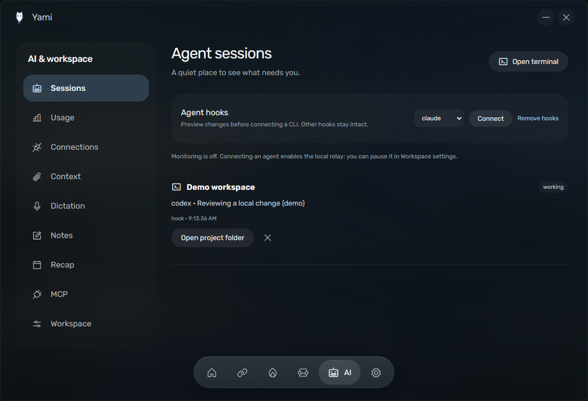
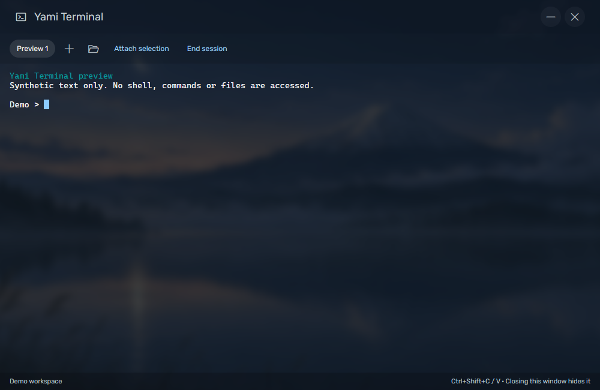

# AI workspace and Yami Terminal

The AI dock tab extends Yami's existing settings navigation, rounded controls,
Phosphor icons, status pills and reduced-motion transitions. It contains Sessions,
Usage, Connections, Context, Dictation, Notes, Recap, MCP and Workspace settings.
The island's AI utility shows a compact activity view and pending decisions.
The implementation is available in the current development checkout; no new public
release has been published.

## Terminal

Open the terminal from Sessions or the island AI utility. Set a global launch
shortcut in Workspace; the main Hotkeys switch also controls this shortcut.
The default shortcut is empty to avoid taking an existing key combination.
Auto shell prefers PowerShell 7, then Windows PowerShell, then Command Prompt.
You can explicitly choose a shell, open a working folder, add up to eight tabs,
resize, paste/copy with Ctrl+Shift+V/C, interrupt with Ctrl+C and attach selected
output to chat. Closing the terminal window hides its live sessions. End session
terminates that shell and its descendants; quitting Yami terminates all owned
shells. It is an interactive Windows PTY, not the assistant's one-shot shell tool.

The default background follows Yami's image, with a bundled fallback, 6px blur
and 22% opacity. Choose a static JPG/PNG (up to 15 MB), no background, blur 0–30px
and opacity 0–80%. Scrollback defaults to 3,000 lines and is bounded at 10,000.
Images do not change the Windows wallpaper. xterm.js and node-pty/ConPTY load on
demand; shells do not start at Yami idle. The output bridge applies backpressure.
Windows Job Objects own the helper and shells so descendants are also reaped.
WSL selection, panes, SSH management and Terax's Ghostty GPU renderer are outside
this selected terminal scope; this is not full Terax parity.

## Agent sessions and decisions

Connect previews a CLI configuration diff, then applies only Yami hooks after
confirmation. Existing settings and unrelated hook entries remain intact. A
dated backup precedes replacement; changing the file after preview invalidates
the plan. Remove hooks uses the same preview flow. Restart the relevant CLI to
load changes. The relay is enabled when connecting; Workspace can pause it.

| Adapter | Installed by Yami | Decision behavior |
| --- | --- | --- |
| Claude Code | User settings command hooks | One-time permission Allow/Deny and AskUserQuestion answers. |
| Codex | User hooks.json | Permission response contract; CLI version must support these hooks. |
| Gemini CLI | User settings command hooks | Activity; approvals stay in the CLI. |
| Copilot CLI | User yami.json hooks, PowerShell/bash commands | Permission responses where supported by the CLI version. |
| Cursor | User hooks.json | Activity; approvals stay in Cursor. |
| OpenCode | Generated user plugin | Activity; approvals stay in OpenCode. |

Sessions distinguish idle, thinking, working, waiting, finished, error and
disconnected. The island reuses Yami's active-work pose and pill. A return action
focuses a reported ancestor window where available, with an honest project-folder
fallback. It cannot promise a precise tab in an external terminal/editor.
Reported file paths can open a bounded tracked Git diff against HEAD.

The short-lived relay authenticates to a per-profile named pipe and checks the
server's Windows user. The UI must acknowledge displaying a pending request
within 1.2 seconds. Otherwise the CLI keeps control; no permission is silently
granted. Displayed requests expire after roughly 108 seconds. Replies preserve
the source agent's request format; they are independent of Yami's Gemini tools.

Optional transcript fallback watches local Claude/Codex logs only when enabled.
It reads bounded recent tails and labels the source as transcript. Inferred
waiting/finished states can be wrong and never grant permission. Fresh hook
events take precedence. No transcript is uploaded by monitoring.

## Subscription allowance

Usage has Codex, Claude, Cursor, Copilot, OpenCode Go, Grok and custom endpoint
readers. Each displays its actual source, fetch time, named windows/reset times
and fresh/stale/authentication/backoff/error/unavailable state. Missing values
remain unknown. These numbers are subscription quota, not inferred token cost
or API billing. Account access is read-only: Yami does not initiate sign-in,
refresh credentials, switch accounts or use reset credits.

Codex uses a bounded `codex app-server` initialize/initialized/account-rate-limits
exchange. Choose its executable when discovery cannot find it. Claude reads its
existing CLI credential and compatibility-sensitive, unpublished OAuth usage API;
multiple `.claude-*` profiles can supply separate groups. Cursor reads its local
credential database; Copilot uses existing gh/environment credentials; OpenCode
Go reads the Go credential, separately from Zen; Grok accepts the exact trusted
issuer's unexpired credential. These provider-specific endpoints can change.
The custom endpoint accepts named `windows` with `usedPercent`/`resetsAt`, or
Claude-style utilization windows. Configure an HTTPS or local URL and optional
encrypted credential; redirects carrying credentials are blocked.

Manual refresh is the default. Optional five-minute background refresh covers
previously queried available readers. Allowance/reset alerts default off; alerts
use 90% used or successive fresh reset evidence, never a stale/startup guess.
Provider retry deadlines are honored. Claude successful reads have a five-minute
floor (including failures). Real signed-in account/CLI-version compatibility remains unverified on
this machine; fixture data is not a successful account read.

## Connections, local models and MCP

Service connectors are opt-in and read operational status. GitHub shows own open
PRs/checks and requested reviews; Vercel shows deployments; n8n reads execution
status from the chosen server; Notion searches accessible pages; Cal.com lists
upcoming bookings; Resend shows email delivery; Stripe shows charges. Open links
to act in the source service. Yami does not send email, charge customers or
publish deployments through these connectors. Tokens need the service's relevant
read permissions. n8n requires its server URL.

Connections default to manual refresh. Explicit background refresh defaults to
300 seconds (60–3,600 seconds configurable), deduplicates concurrent requests
and backs off on rate limits. Initial data does not trigger a change alert.
Disabled or removed connections stop scheduling. Existing in-flight HTTP work
has a 15-second bound and is ignored if the connection is disabled/changed.

Local model server supports OpenAI-compatible `/models` and streamed or JSON
`/chat/completions`, model selection, cancellation and hiding `<think>` content.
Default URL is `http://127.0.0.1:11434/v1`. Yami does not launch/download a model.
This separate single-prompt text surface does not route Gemini voice/tools or
subscription credentials into another provider. Disconnect clears its key/model.

MCP is an optional HTTP Streamable MCP client: initialize, discover tools, inspect
JSON input and confirm each advertised tool call in Yami. Tools do not become
automatic assistant tools. HTTP SSE/JSON responses are bounded. Stdio servers,
OAuth account setup, a connector marketplace and remote mobile relay are not
implemented. Use trusted servers; confirmed MCP tools may have side effects.

## Dictation, notes and selected context

Choose Gemini (default) or an installed Windows speech recognizer in Dictation.
Windows transcription accepts 16 kHz mono PCM WAV, stays local and needs a
recognizer installed in Windows. It uses System.Speech, not a bundled Whisper
model. Dictionary rules replace whole words/phrases with Unicode boundaries.
Spoken snippets replace an entire utterance; they never execute its text.
Optional per-app natural/polished cleanup sends dictated text to Gemini only for
apps explicitly configured; verbatim is the default. Copy last dictation is local.

Notes stores and searches plain text locally. Explicit meeting recording can use
the microphone, Windows system audio or both, after acknowledging participant
awareness. PCM streams into a bounded temporary file; stop transcribes in
five-minute chunks. Provider/save failures retain audio for retry while the view
remains open. Discard, closing the owner window or quitting removes temporary
audio; quitting warns while recording/transcription is pending. Do not treat
temporary audio as crash recovery or durable recording storage. Gemini sends
audio to Google; Windows speech stays local. Summarize with Gemini is separate
and explicit. Checklist proposals can be added individually to Desk. Save the
note after editing or generating a summary. No proposed action runs automatically.

Attach chosen text/code files, tracked Git diffs, a terminal selection or selected
accessible window text. Preview the content first. Nothing is submitted until
the user sends chat. Private/password-window exclusions are heuristic. Individual
items expire after an hour and are bounded; a message plus up to five attachments
must fit 20,000 characters. Binary files are rejected.

Recap counts local agent phase changes over the last seven days. Retention is
seven days by default, up to 90; zero disables retention. It does not estimate
productive hours, cost, tokens or quality from activity.

## Verification and remaining gaps

On 2026-10-18, source and unpacked packaged Windows builds passed real PTY state,
resize, Ctrl+C, native relay Allow/Deny, visible-card ACK, descendant cleanup and
fixture-chat preservation. Contract tests cover named-pipe authentication,
fallback/questions, configuration merging, quota semantics, local HTTP/MCP,
credential validation and recording failure/retry/commit. Offline speech passed
using synthesized WAV audio and the installed recognizer. Browser fixtures pass
all 17 screens and all nine AI subsections without external requests.

Live provider accounts, live service credentials, each installed agent release,
microphone quality and system-audio capture across devices have not been tested.
Neither full upstream parity nor release readiness is claimed. Source revisions,
licenses and initial scope remain in the [adaptation review](research/adaptation-review.md).
See [performance](performance.md) for measured memory and its unmet target.
