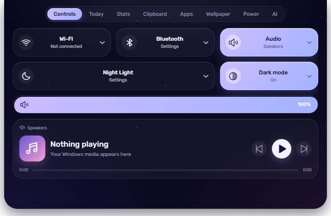

# Yami

Yami is a free, open-source desktop companion for Windows. A small spirit lives in an island at the top of your screen, and from there you can talk to her, dictate into any app, convert files with a drag, tune Windows, control your music, keep plans, and hand work to coding agents. Every feature is optional: you choose what Yami does when you first start her, and anything you leave off costs nothing.

| Home | Loadout | Spirit island |
| --- | --- | --- |
|  |  |  |

## Highlights

- **Talk and dictate.** Hold a shortcut to talk to Yami, or to dictate into any text field, online with your own free Gemini key or fully offline.
- **The island.** Media controls, a calendar and timers, system stats, clipboard history, apps, wallpapers, radio and power, one hover away.
- **File wheel.** Drag a file and tap a key to convert, compress, rename or edit it, without opening another app.
- **Tune Windows.** Tweaks with exact undo, startup apps, DNS and a local ad-blocking network shield, cleanup, disk space, and more.
- **For developers.** Projects, a terminal, one-click coding agents, agent status in the island, and an MCP endpoint so agents can call Yami.
- **Your desktop, your way.** A dock, a desk clock widget, a light private browser, a download manager with a new-tab extension, and a phone remote.

## Get Yami

Download the portable `.exe` from [Releases](https://github.com/sico-vibes/Yami/releases) and run it. It is not signed yet, so Windows SmartScreen asks first: choose **More info**, then **Run anyway**. Yami runs on Windows 10 and 11.

Start with [Getting started](docs/getting-started.md), then browse the [documentation](docs/README.md).

## Privacy in one paragraph

Yami keeps your data on your PC. Online features use accounts you connect yourself (for example a free Gemini API key), and keys are encrypted with Windows. Nothing is sent anywhere until you turn on a feature that needs it, and each one says what it sends. See [Providers and privacy](docs/providers-and-privacy.md).

## Found a bug?

In Yami, open **Settings › Your data › Report a bug**. It collects a report with recent logs (secrets masked) and opens a GitHub issue for you to attach it to. Security problems: please [report them privately](SECURITY.md).

## Build from source

On Windows with Node.js 24:

```powershell
npm install
npm run dev
```

`npm install` also turns on the pre-push checks. See [CONTRIBUTING.md](CONTRIBUTING.md) for the code standards, and [docs/internal](docs/internal/index.md) for the full developer reference: architecture, security, performance and the release process.

## License

Yami's own code is [MIT licensed](LICENSE). Third-party libraries, fonts, icons and data keep their own licenses, listed in [assets and licenses](docs/internal/assets-and-licenses.md). The starter wallpapers were made for Yami.

Yami is an independent project inspired by other desktop companions. It is not affiliated with, or endorsed by, any of them.
