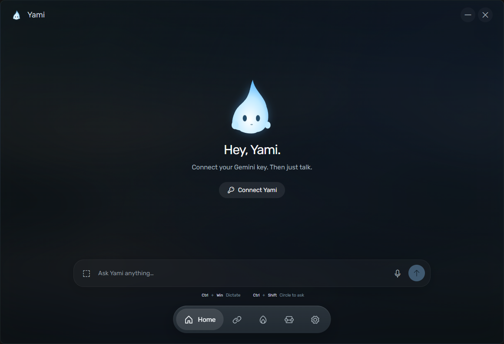
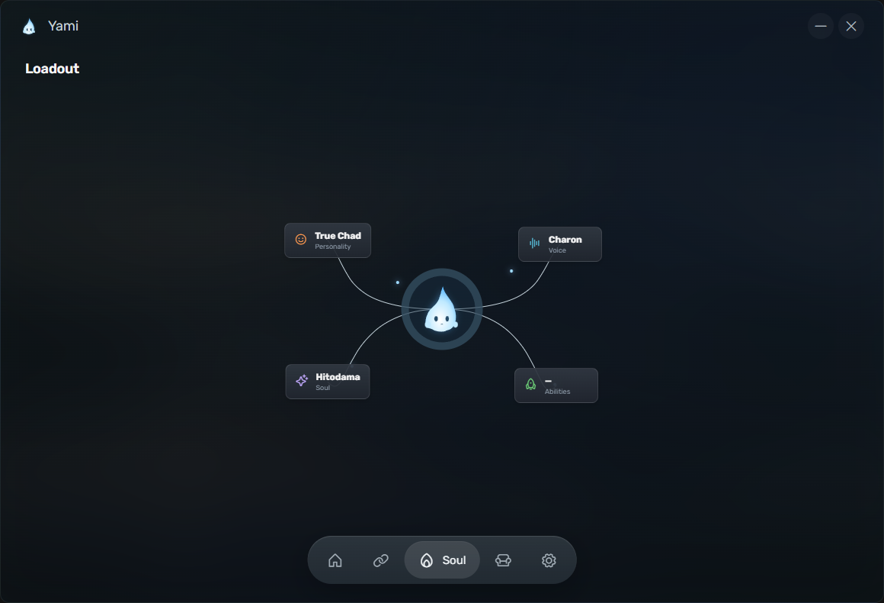
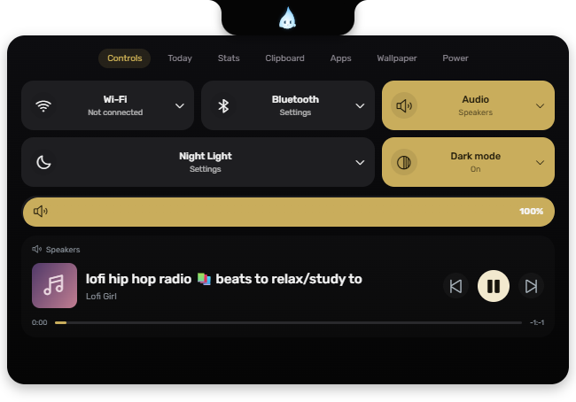
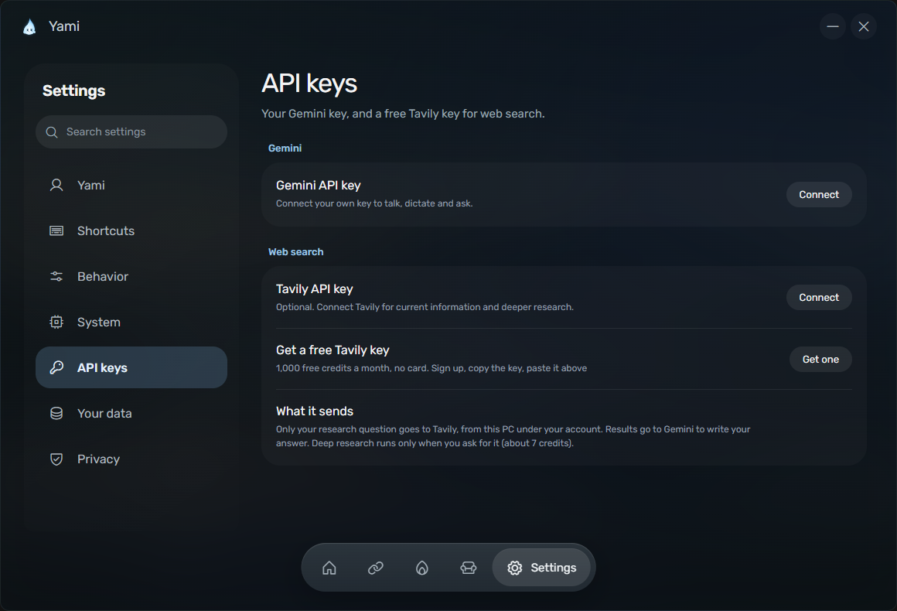
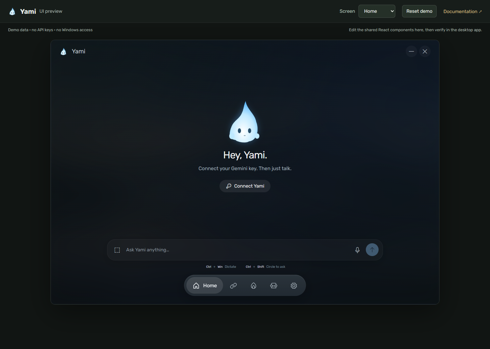

# Yami

Yami is a Windows desktop companion with a small spirit island, voice conversation, dictation, screen selection, local Windows controls, and an optional Gemini-powered assistant. It is a community reconstruction inspired by supplied visual references. It does not claim exact Hitodama behavior or affiliation.

The application is free and open source under the MIT License. The repository is private while development continues. A key requirement applies to online AI features: you bring your own provider keys, and provider pricing, free quotas, geography, eligibility, and terms can change. “Free tier” does not mean unlimited or universally available.

## Screenshots

| Home | Loadout | Spirit island |
| --- | --- | --- |
|  |  |  |

| Settings | Web preview |
| --- | --- |
|  |  |

## Starter wallpapers


Ten original, character-free Japanese landscapes in one 1920 × 1280 pack. [Browse the pack and provenance](Documentation/wallpapers.md).

## Start here

- [Documentation index](Documentation/index.md) — guided map of all project docs.
- [Standalone documentation viewer](Documentation/index.html) — a local browser reader built from the Markdown guides.
- [Getting started](Documentation/getting-started.md) — install, launch, configure provider keys, and try the main workflows.
- [Feature and settings guide](Documentation/features-and-settings.md) — shipped capabilities and current defaults.
- [Security and provider data flow](Documentation/security-and-providers.md) — exact network destinations, local storage, permissions, and confirmation rules.
- [Architecture](Documentation/architecture.md) — renderer, Electron main process, IPC, and native Windows host.
- [Development, build, and release](Documentation/development.md) — local workflow, checks, package targets, and contribution rules.
- [Performance goals](Documentation/performance.md) — Windows-first idle behavior and measurement gates.
- [Roadmap](Documentation/roadmap.md) — ideas that are planned rather than shipped.
- [Asset and third-party provenance](Documentation/assets-and-licenses.md) — artwork, data, fonts, icons, and bundled dependencies.

## Development at a glance

On Windows with Node.js/npm installed:

```powershell
npm install
npm run dev
```

For the full Windows build and portable package, see [Development, build, and release](Documentation/development.md). Web preview is for renderer/UI work with a fixture bridge. It does not provide Windows controls, microphone capture, screen capture, or native actions.

## Project status

The packaged idle sample used about **166 MB private RAM** across the process tree (about **536 MB including shared pages**). The 50–100 MB idle target is not met, and the active-task ceiling has not been verified. [Conditions, samples, and optimization priorities](Documentation/performance.md).

Yami is a reconstruction. Unknown original prompts, hidden screens, custom voice mappings, reward rules, and animation timings cannot be recovered from the references. Current features and limitations are described from the code that ships in this repository. Future ideas are marked **Planned** in the roadmap.

An initial short idle sample of the production-source Electron build recorded 165–168 MB summed private working set and 706–708 MB including shared pages across eight Yami processes. It used three snapshots after a 10-second settle with clipboard, app context, and weather off; the packaged build and sustained behavior remain to be measured. The 50–100 MB idle aspiration is **not met** in this sample. See [Performance goals](Documentation/performance.md) for hardware, CPU readings, method, and limits.

## License

Yami-authored source is licensed under MIT; third-party libraries and data retain their own licenses. Bundled starter wallpapers and other artwork have asset-specific provenance documented in [Asset and third-party provenance](Documentation/assets-and-licenses.md). Do not assume the reference wallpapers are Yami-owned or redistributable.
